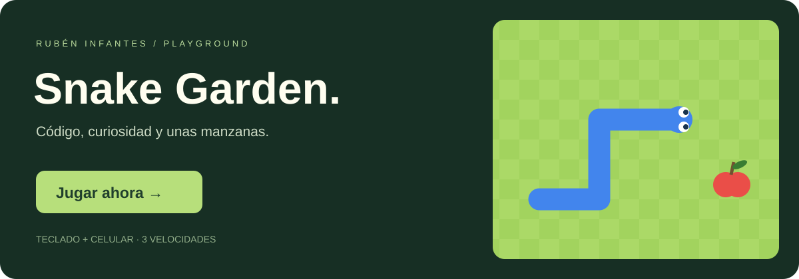

# Hola, soy Rubén Infantes 👋

Estudiante de Ingeniería de Software e Inteligencia Artificial. Explorando programación, datos y pequeños juegos hechos con código.

### 🐍 Un descanso entre líneas de código

**[Jugar a Snake Garden →](https://ruben-infantes.github.io/Ruben-Infantes/)**

Come manzanas, haz crecer tu culebrita y supera tu récord.

| En computadora | En celular |
| --- | --- |
| Flechas o WASD para moverte | Desliza sobre el tablero o usa los botones |
| Espacio para pausar | Botón Pausa para descansar |

🌱 Tres velocidades · 🏆 Récord local en tu navegador · 📱 Diseño adaptable

El juego se abre en una página aparte: GitHub no ejecuta juegos dentro del README.

Diseño inspirado en los clásicos de Snake. Proyecto independiente, sin afiliación con Google.
